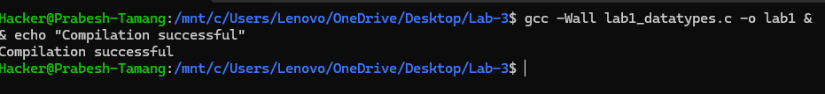
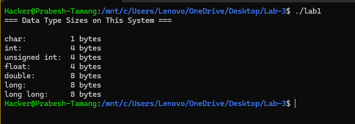
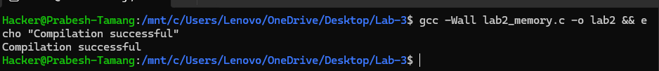
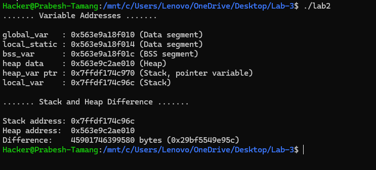

# Lab 3: Data Types and OS Memory Management

**Name:** Prabesh Tamang
**Student ID:** 250500
**College:** Softwarica College of IT and E-Commerce
**Program:** BSc (Hons) Ethical Hacking and Cybersecurity
**Course:** Operating Systems

## Objective
To observe how much memory each C data type uses on this system and to see where different kinds of variables live in a process address space.

## Theoretical Concepts
- **Data type:** a contract between the programmer, compiler and OS that fixes how many bytes to allocate and how to interpret them.
- **sizeof():** an operator that returns the size in bytes of a type or variable.
- **Process address space:** the virtual view of memory the OS gives each process, divided into Text, Data, BSS, Heap and Stack segments.
- **Data segment:** initialized global and static variables.
- **BSS segment:** uninitialized global and static variables.
- **Heap:** dynamically allocated memory (malloc), managed manually and growing upward.
- **Stack:** local variables and function calls, managed automatically and growing downward.
- **Pointers:** a pointer variable lives on the stack but can point to memory on the heap.
- **Virtual memory:** each process has its own isolated address space, mapped to physical RAM by the OS.

## Lab 1: Data Type Size Exploration
**File:** `lab1_datatypes.c`

Uses `sizeof()` to print the size of char, int, unsigned int, float, double, long and long long.

**Compilation:**

**Output:**

**Comparison with Table I:** the output matches the 64-bit column of Table I.

**Question: Why might sizeof(long) differ between 32-bit and 64-bit systems?**

On a 32-bit system, long is 4 bytes, the same as int and the pointer size. On a 64-bit Linux system, long grows to 8 bytes so it can hold a full 64-bit value or address, which is needed for 64-bit addressing and large file offsets.

## Lab 2: Memory Segment Address Mapping
**File:** `lab2_memory.c`

Declares a global initialized variable (Data), a global uninitialized variable (BSS), a static local variable (Data), a local variable (Stack) and a malloc allocated variable (Heap), then prints each address with %p and calculates the difference between the stack and heap addresses.

**Compilation:**

**Output with segment labels:**

**Observations:**

The stack variables have the highest addresses (0x7ffd...), the heap is in the middle (0x563e9c2a...), and the Data and BSS variables have the lowest addresses (0x563e9a18...). The difference between the stack and the heap addresses is 45901746399580 bytes. The pointer variable heap_var lives on the stack, while the memory it points to lives on the heap, which shows how pointers bridge the two segments. The addresses change on every run because the OS randomizes the memory layout (ASLR), but the order of the segments stays the same.

## Conclusion
This lab showed that data types determine how much memory the OS allocates, and that each process sees its memory divided into segments with distinct address ranges, managed by the compiler and the OS.
